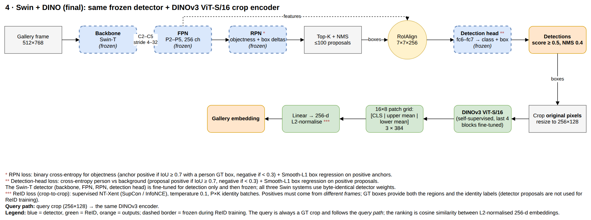
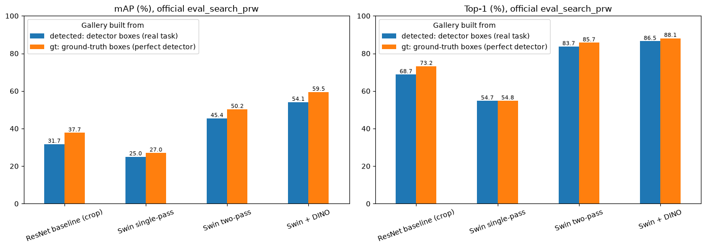
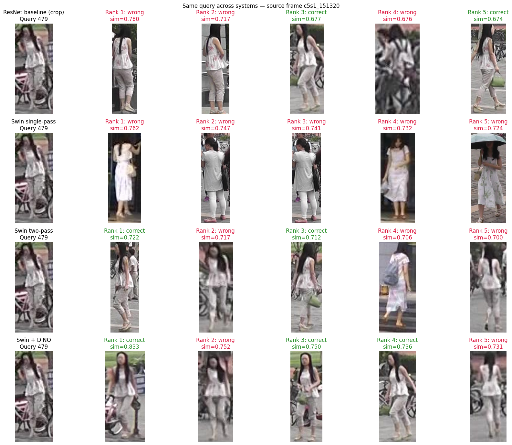
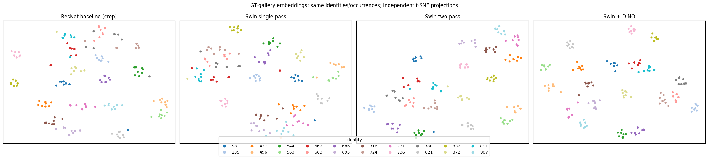
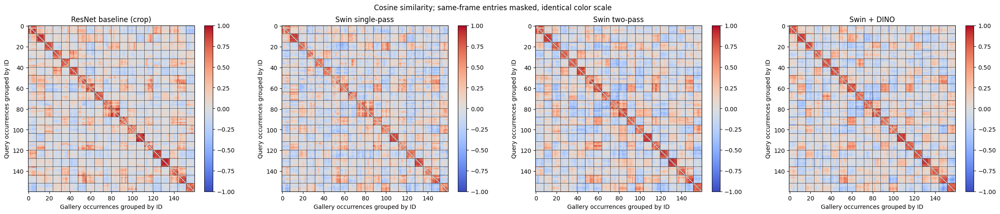

# Person Search on PRW: Swin-T detector + DINOv3 ReID

**Student:** `<FULL NAME>` · `<STUDENT_ID>` · `<name.surname@studio.unibo.it>` · ML4CV assignment, University of Bologna

Given a crop of a person, **find every other appearance of that person** in 6,112 full frames from six campus cameras (the [PRW dataset](https://github.com/liangzheng06/PRW-baseline)). A system has to *detect* every person in every frame and *re-identify* them, ranking the detections by their similarity to the query.

The final system pairs a fine-tuned **Swin-T Faster R-CNN** detector with a separate **DINOv3 ViT-S/16** ReID encoder. It reaches **54.1 mAP / 86.5 top-1** on the PRW test set with the official `eval_search_prw`, which is in the range of published end-to-end methods such as COAT (≈ 53 / 87).

▶ **[Run it on Kaggle](https://www.kaggle.com/code/saadqasimabbasi/prw-person-search-evaluation)**: no setup, no secrets. Click *Copy & Edit* and then *Run All*. [`main.ipynb`](main.ipynb) contains the full run with all outputs. If GitHub does not display it, [view it on nbviewer](https://nbviewer.org/github/SaadQAbbasi/ML4CV-Assignment/blob/main/main.ipynb).

## The final pipeline



1. **Detect.** The Swin-T Faster R-CNN (512×768) is fine-tuned for detection only, then frozen. It keeps boxes with confidence ≥ 0.5.
2. **Re-crop.** Each box is cut out of the *original-resolution* frame and resized to 256×128.
3. **Embed.** The DINOv3 ViT-S/16 (last 4 blocks fine-tuned with SupCon) produces `[CLS | mean of upper-half patches | mean of lower-half patches]`, which is projected to an L2-normalised 256-d embedding.
4. **Rank.** Gallery detections are ranked by cosine similarity to the query.

## Results

Four systems form an ablation chain. All results use the official `eval_search_prw` on the 2,057 PRW test queries.

| System | Gallery ReID features | mAP | Top-1 |
|---|---|---|---|
| ResNet baseline | jointly trained ResNet-50 Faster R-CNN, crops re-encoded by the same backbone | 31.7 | 68.7 |
| Swin single-pass | RoIAlign on the **frozen detector features** + trained ReID head | 25.0 | 54.7 |
| Swin two-pass | **re-cropped pixels** → separate ImageNet Swin-T | 45.4 | 83.7 |
| **Swin + DINO (final)** | re-cropped pixels → **self-supervised DINOv3 ViT-S/16** | **54.1** | **86.5** |



*detected* = the gallery is the detector's boxes (the real task). *gt* = the gallery is the ground-truth boxes, i.e. a perfect detector.

**Main findings**
- **Re-cropping beats reusing detector features (+20.4 mAP).** With the same detector, a dedicated encoder on the original pixels is far better than ReID on the frozen detection features. Those features are trained to make all people look like "person", so they lose identity detail.
- **A self-supervised backbone helps (+8.6 mAP).** Swapping the supervised Swin-T crop encoder for DINOv3, with everything else unchanged, gives the largest gain after the architecture change.
- **Upper/lower pooling beats the plain CLS token (+1.0 to 1.2 mAP).** In a pedestrian crop the top half is mostly the upper body and the bottom half the legs. Pooling them separately keeps the "top colour vs bottom colour" cue. Averaging *all* patches gave no gain.
- **ReID, not detection, is the bottleneck.** A perfect detector would add only about 5 mAP.

## Qualitative results

The same query for all four systems: top-5 results, green = correct, red = wrong. The query person is partly occluded by a bicycle. The single-pass model returns five wrong people in similar light clothing, while the two-pass and DINO systems find her at rank 1.



**Embedding space.** t-SNE of 20 test identities × 8 appearances (one colour per person). The re-cropping systems form tight, separate clusters, and DINO's are the tightest.



<details>
<summary>Query-vs-gallery cosine similarity matrices</summary>



</details>

The notebook contains the full discussion, nine more query examples and the limitations.

## Repository layout

```
main.ipynb          the submitted notebook: evaluation, ablation, qualitative results (with outputs)
src/                the project modules (model, data, losses, training and evaluation code)
training/           the four Kaggle notebooks that produced the published weights
tests/              unit tests (unittest)
tools/              prepare_kaggle_datasets.py: builds the Kaggle code/weights datasets (author only)
docs/diagrams/      pipeline diagram of each system (draw.io source + PNG)
docs/images/        figures from main.ipynb used in this README
TRAINING.md         chronological log of every experiment, including the ones not kept
requirements.txt    packages for running the code locally
```

`src/` modules:

```
eval_function.py           official eval_search_prw (provided with the assignment, unmodified)
official_evaluation.py     adapter: converts project outputs into eval_search_prw inputs
prw_evaluation.py          gallery detection/embedding, query embedding, in-house ranking, detector P/R
final_comparison.py        model loading, diagnostic sample and plots used by main.ipynb
prw_dataset.py             PRW annotation/frame loading, crop preprocessing, P×K identity sampler
retrieval_diagnostics.py   detector precision/recall matching
model.py                   Faster R-CNN person-search model (ResNet-50 / Swin-T backbone)
backbone.py, fpn.py, rpn.py, roi_heads.py   detector components
swin_reid.py               Swin single-pass (scene RoI head) and two-pass (crop encoder) ReID
dino_reid.py               detector + crop-encoder wrapper (DinoPersonSearch) and the crop training epoch
dinov3_reid.py             DINOv3 crop encoder with CLS / patch-region pooling
metric_loss.py             triplet, contrastive and supervised NT-Xent (SupCon) losses
training.py                joint training/validation loops, W&B run setup, AMP helpers
detection_training.py      detection-only training epoch and AP50/AP75 evaluation
validation_retrieval.py    retrieval mAP on the validation frames (checkpoint selection)
offline_mining.py          P×K sampler with optional hard-identity mining
```

## How to run `main.ipynb`: on Kaggle

The notebook is designed to run **on Kaggle** and needs no accounts, tokens or secrets.

**Public Kaggle notebook (inputs already attached):** https://www.kaggle.com/code/saadqasimabbasi/prw-person-search-evaluation

1. Open the link above and click **Copy & Edit**.
2. Settings: **Accelerator → GPU T4 ×1** (or P100). Internet is not required.
3. **Run All.** The full evaluation of the four systems takes about 1 h 55 min on a T4.

The submitted `main.ipynb` already contains every output of that full run, so it can be read without being run.

**Quick run (optional).** To check that the notebook runs end to end without waiting for the full evaluation, open the configuration cell in section 2.2, set `QUICK_RUN = True` and then *Run All*. Every system is evaluated on only the first `QUICK_GALLERY_FRAMES = 300` test frames, and every section still produces its tables and figures. The quick-run mAP / top-1 are **not** comparable to the reported results. Those come from the full run with `QUICK_RUN = False`, which is the default.

To start instead from `main.ipynb`: create a new Kaggle notebook, use *File → Import Notebook*, and attach these three public datasets with *Add Input*:

| Input | Kaggle dataset | Content |
|---|---|---|
| PRW dataset | [`edoardomerli/prw-person-re-identification-in-the-wild`](https://www.kaggle.com/datasets/edoardomerli/prw-person-re-identification-in-the-wild) | frames, annotations, queries |
| Code | [`saadqasimabbasi/prw-person-search-code`](https://www.kaggle.com/datasets/saadqasimabbasi/prw-person-search-code) | the `src/` modules + a DINOv3 code snapshot |
| Weights | [`saadqasimabbasi/prw-person-search-weights`](https://www.kaggle.com/datasets/saadqasimabbasi/prw-person-search-weights) | the five trained checkpoints |

The notebook finds the three inputs automatically, wherever Kaggle mounts them under `/kaggle/input`. Results (CSV, JSON, PNG) are written to `/kaggle/working/final_prw_comparison`.

## Model weights

The weights dataset contains:

| File | System | Produced by |
|---|---|---|
| `resnet_baseline.pt` | ResNet baseline (joint detection + ReID) | `training/01_joint_person_search.ipynb`, `CONFIG = "resnet_baseline"` |
| `swin_detector.pt` | Swin-T detector shared by the three Swin systems | `training/02_swin_detector.ipynb` |
| `swin_single_pass.pt` | Swin single-pass (frozen detector + scene RoI ReID head) | `training/03_swin_reid.ipynb`, `STRATEGY = "crop_to_scene"` |
| `swin_two_pass.pt` | Swin two-pass (frozen detector + Swin-T crop encoder) | `training/03_swin_reid.ipynb`, `STRATEGY = "crop_to_crop"` |
| `swin_dino_reid.pt` | DINOv3 ReID encoder (final system) | `training/04_dinov3_reid.ipynb` |

Each file is the exact W&B artifact version listed in the `main.ipynb` manifest, with the optimizer state removed.

## Retraining the models

Each notebook in `training/` reproduces one published checkpoint on a Kaggle T4. Like `main.ipynb`, they locate their inputs under `/kaggle/input` automatically. W&B logging is off unless you set `USE_WANDB = True`. The notebooks depend on each other's outputs: attach a notebook's output as an input of the next one with *Add Input → Notebook Output*.

```
01_joint_person_search ──► resnet_baseline.pt                       (CONFIG = "resnet_baseline")
                       └─► joint_swin_t_triplet.pt ──┬─► 02_swin_detector ──► swin_detector.pt ──► 03_swin_reid ──► swin_single_pass.pt
                           (CONFIG = "joint_swin_t_   │                                                         └─► swin_two_pass.pt
                            triplet")                 └─► 04_dinov3_reid ──► swin_dino_reid.pt  (validation detector)
```

| Notebook | Inputs besides PRW + code | Output | Run time (T4) |
|---|---|---|---|
| `01_joint_person_search` | none | `resnet_baseline.pt` / `joint_swin_t_triplet.pt` | ≈ 3.1 h / 2.6 h |
| `02_swin_detector` | `joint_swin_t_triplet.pt` | `swin_detector.pt` | ≈ 4 h |
| `03_swin_reid` | `swin_detector.pt` (from 02 or the weights dataset) | `swin_single_pass.pt` / `swin_two_pass.pt` | ≈ 5.3 h / 2.9 h |
| `04_dinov3_reid` | `joint_swin_t_triplet.pt`, DINOv3 ViT-S/16 pretrained weights | `swin_dino_reid.pt` | ≈ 2.7 h |

Each notebook starts with what it trains, its full configuration, and how the published checkpoint was selected. `04_dinov3_reid` needs Meta's pretrained `dinov3_vits16_pretrain_lvd1689m-08c60483.pth`. It is distributed under the DINOv3 license, so download it from the [DINOv3 repository](https://github.com/facebookresearch/dinov3) and upload it as a private Kaggle dataset. Exact numbers can differ slightly between runs because GPU training is not bit-wise deterministic.

`TRAINING.md` records every experiment chronologically, including the variants that were tried and discarded: losses, DINOv2/DINOv3 poolings, hard mining and so on.

## Running locally (optional)

```bash
python3 -m venv .venv
.venv/bin/python -m pip install torch==2.11.0 torchvision==0.26.0 --index-url https://download.pytorch.org/whl/cu128
.venv/bin/python -m pip install -r requirements.txt
PYTHONPATH=src .venv/bin/python -m unittest discover -s tests     # unit tests, no data needed
```

To run a notebook outside Kaggle, point `PRW_INPUT_ROOT` at a folder that contains the PRW dataset, `src/` and the checkpoints, and set `PRW_WORKING` to an output folder.

## Publishing the datasets (author only)

From the repository root, with W&B access and the [Kaggle CLI](https://github.com/Kaggle/kaggle-api) configured:

```bash
.venv/bin/python tools/prepare_kaggle_datasets.py --kaggle-user <kaggle-user>
kaggle datasets create -p kaggle_upload/code --dir-mode zip --public     # later updates: kaggle datasets version ...
kaggle datasets create -p kaggle_upload/weights --public
```

The code dataset includes a snapshot of [facebookresearch/dinov3](https://github.com/facebookresearch/dinov3) (DINOv3 license) so the architecture loads without Internet.
